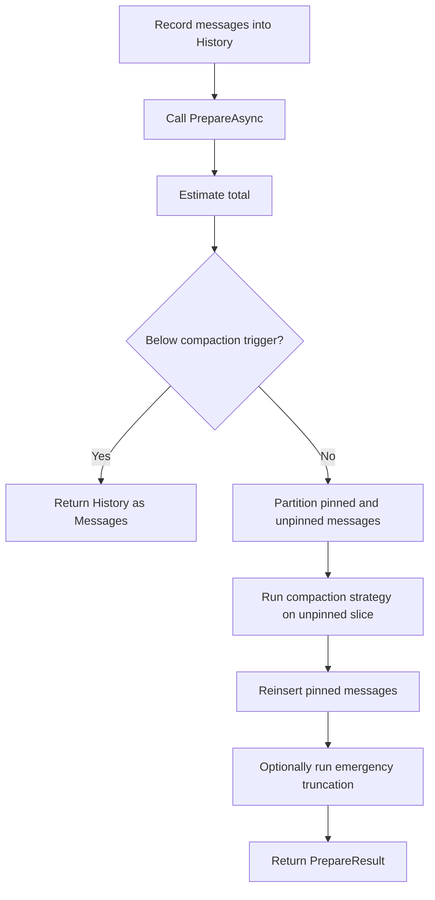

# How TokenGuard Thinks About Context

TokenGuard manages one hard problem in long-running agent loops: every model call must resend the conversation, but most
of that conversation quickly becomes stale. This document explains how the current implementation handles that pressure.

---

## 1. Why context management exists

LLMs are stateless from the application's point of view. Each request resends the active conversation. Agent loops make
this expensive fast:

1. model responds
2. model requests tools
3. app executes tools
4. app records tool results
5. next request resends all of it

Without compaction, input tokens grow cumulatively across the session. Eventually one of three things happens:

- prompt cost becomes unreasonable
- latency climbs because every request carries stale history
- provider rejects the request when the context window is exceeded

TokenGuard keeps full recorded history for correctness, but prepares a smaller provider payload when pressure rises.

---

## 2. Two views of the conversation

TokenGuard maintains two distinct views:

- **History**: `ConversationContext.History` is the full recorded transcript. Recording APIs append to this list. It is
  never compacted in place.
- **Prepared view**: `PrepareAsync()` returns a `PrepareResult`. `PrepareResult.Messages` is the list to send to the
  provider for the next call.

That separation is the central design choice. Recorded history stays complete. Prepared history is ephemeral.



Because `PrepareAsync()` always reevaluates full history, compaction can run on every later turn once the session is
large enough. That is expected. The prepared view is not persisted back into history.

---

## 3. What `PrepareAsync()` actually returns

`PrepareAsync()` returns `PrepareResult`, not a bare message list.

| Property | Meaning |
|---|---|
| `Messages` | Prepared message list for the provider call |
| `Outcome` | `Ready`, `Compacted`, `CompactionInsufficient`, or `CannotCompact` |
| `TokensBeforeCompaction` | Estimated total of the recorded history before any compaction or truncation ran, including the provider correction |
| `TokensAfterCompaction` | Estimated total of the returned `Messages` on the same scale. `Outcome` is decided from it |
| `MessagesCompacted` | Count of messages replaced or dropped during this call |
| `MessagesDropped` | Count of messages removed specifically by emergency truncation |
| `BudgetFailureReason` | Diagnostic text for over-budget outcomes |
| `SummarizationError` | The exception captured when LLM summarization failed during this call and TokenGuard fell back to sliding-window masking; `null` otherwise. Caller cancellation is not reported here |

That shape matters for consumers:

```csharp
var prepared = await context.PrepareAsync(cancellationToken);

if (prepared.Outcome == PrepareOutcome.CannotCompact)
    throw new InvalidOperationException(prepared.BudgetFailureReason);

var requestMessages = prepared.Messages.ForOpenAI();
```

The adapters operate on `PrepareResult.Messages`, not on `PrepareResult` directly.

---

## 4. Token estimation and anchor correction

TokenGuard needs an estimate before sending a request, but provider truth is only known after the request completes.

The built-in `EstimatedTokenCounter` is more than a character-count heuristic:

- every `ContextMessage` includes fixed framing overhead
- tool segments include envelope and field overhead
- JSON-like payloads are counted structurally, plus the whitespace between their tokens: outside string literals, each
  run of spaces, tabs and line breaks costs 1 token, 1 more when it holds a line break, and 1 more again when a run with
  a line break holds a tab. The rule was fitted to the `o200k_base` encoding (tiktoken 0.14.0); minified JSON pays
  nothing for it
- Unicode, punctuation, code-like text, paths, and emoji are handled with specialized heuristics
- the built-in factory uses `new EstimatedTokenCounter()` with `TokenCountSafetyMode.Balanced`
- public DI and factory configuration do not expose a token-counter replacement hook today

So the real shape is closer to:

```csharp
var total = messageOverhead
          + segmentEstimates
          + toolEnvelopeOverhead
          + optionalSafetyMargin;
```

This still is an estimate. To reduce systematic drift, `RecordModelResponse(..., providerInputTokens)` feeds actual
provider counts back into the context.

The anchor correction, also called the provider correction, is:

```text
anchorCorrection = providerInputTokens - sum(lastPreparedMessages)
anchorBase       = sum(lastPreparedMessages)
```

`sum(...)` is the sum of the per-message estimates, without any correction. The correction stays in effect on every
later `PrepareAsync()` call, including calls that compact, until the next provider report replaces it. This lets
TokenGuard compensate when the heuristic is consistently high or low for a given provider and workload.

Every total that `PrepareAsync()` reports or compares uses one scale:

```text
corrected(messages) = sum(messages) + anchorCorrection                                if sum(messages) >= anchorBase
corrected(messages) = sum(messages) + anchorCorrection * sum(messages) / anchorBase   otherwise (rounded toward zero)
```

A list at least as large as the payload the provider measured gets the whole correction, so messages recorded since the
report count at their estimate. A smaller list, such as a compacted view, gets a proportional share, because the
correction was learned on more content than the list still holds. A payload unchanged since the report totals exactly
the provider count.

`TokensBeforeCompaction` is `corrected(history)` and `TokensAfterCompaction` is `corrected(prepared.Messages)`. The
compaction trigger, the emergency trigger, and the outcome are all compared on this scale, so a call that changes no
messages reports the same figure twice. With no provider report recorded, the correction is zero and every figure is the
plain sum.

The strategy itself works on per-message estimates, so the budget it receives is converted to that scale (section 5).
The `tokenguard.compact` activity tags report the converted `availableTokens` and the strategy's own estimates.

---

## 5. The compaction pipeline

The built-in pipeline is `TieredCompactionStrategy`:

1. sliding-window masking always runs first
2. LLM summarization runs only if masking still exceeds the available token budget and a summarizer is registered
3. emergency truncation runs afterward inside `ConversationContext` when the prepared result is still above the
   emergency trigger

The threshold check in `ConversationContext` is against the full history estimate with any active anchor correction
applied (section 4 defines `corrected`):

```text
totalBeforeCompaction = corrected(history)
```

If that total is below `ContextBudget.CompactionTriggerTokens`, the context returns `Ready` and skips all strategy work.

If it is above the trigger:

1. pinned messages are extracted
2. `MaxTokens` is converted to the estimate scale, and the pinned messages' estimated cost is subtracted from it
3. only the unpinned slice is passed to the strategy, with that budget as `availableTokens`
4. pinned messages are put back between the surviving messages they were recorded between
5. emergency truncation may remove old unpinned turn groups from the prepared list
6. `PrepareResult` is built from the final prepared list

The trigger compares the corrected history, while the strategy counts estimates. The budget is converted with the two
figures the trigger already has:

```text
s               = sum(history) / corrected(history)    (1 when either is zero or less)
availableTokens = floor(MaxTokens * s) - pinnedTokenTotal
```

With no provider report the correction is zero, `s` is 1, and `availableTokens` is `MaxTokens - pinnedTokenTotal`. When
the provider counts fewer tokens than the estimate, `s` is above 1 and the strategy may keep more estimated tokens;
when it counts more, `s` is below 1, so a history whose estimate fits the maximum but whose corrected total does not
reaches summarization instead of emergency truncation. `s` is recomputed on every call and not rounded.

A custom `ICompactionStrategy` receives the converted budget in the same parameter; its signature is unchanged.

---

## 6. Sliding-window masking

`SlidingWindowStrategy` is the always-on first stage.

It walks backward from the newest compactable message and builds a protected tail:

- it always protects at least `SlidingWindowOptions.WindowSize` newest messages
- after that floor is satisfied, it keeps expanding the tail while token cost stays within an allowance

Nothing is masked while the whole compactable history fits in the high mark, `availableTokens * ProtectedWindowFraction`
(80% by default). Once the history exceeds it, the boundary between masked and whole messages moves in steps:

- the low mark is the high mark minus one quarter of it, 60% of `availableTokens` by default
- the step is one quarter of the high mark of the unconverted budget, `MaxTokens - pinnedTokenTotal`: 20% of that budget
  by default, and not configurable
- step lines are fixed positions in the history: index 0, and the first message boundary at or after each multiple of
  the step, counted in tokens from the oldest compactable message
- the boundary is the last step line at or before the point the walk reaches with the low mark as its allowance
- the boundary is never placed before the point the walk reaches with the high mark as its allowance, so the protected
  tail holds between the low mark and the high mark

Between two steps the boundary stays where it is, so a prepared view is the previous view plus the new messages at the
end. A provider prompt cache or a local model server can then reuse the whole previous request. The boundary moves
about once per step of growth. When the newest `WindowSize` messages alone exceed the low mark, the boundary follows
the high-mark walk and can move on every call.

The boundary is derived from the history and `s` on every call. Nothing is remembered between calls, so the same
messages with the same provider correction always give the same view, whether they were recorded one by one or
restored at once. The marks follow `s`, so a change in the correction moves where the low-mark walk ends, but the step
lines it snaps to stay where they were. Step lines depend on `MaxTokens - pinnedTokenTotal`, so pinning a new message
or changing the system prompt can move them once.

Messages before the boundary stay in place, but older `ToolResultContent` segments are replaced with placeholders.

```text
[Tool result removed to save context — read_file, call_abc123. Call the tool again if you need this content.]
```

The placeholder tells the model how to get the content back. A system prompt should say the same, and should not forbid
calling a tool again for content the model has already seen.

Only the `Content` string changes. The segment **stays** `ToolResultContent`. That detail is crucial because provider
adapters dispatch on segment type.

A tool result is replaced only when masking saves tokens. A result whose estimated tokens are not above those of its
placeholder, such as `ok`, an exit code or `File written`, keeps its content, and a message whose results all stay is
returned as it is. The comparison uses the configured `PlaceholderFormat`, so a longer custom placeholder leaves more
short results in place. The check is made per tool result after the boundary is found, so it never moves the boundary
or a step line. `MessagesCompacted` and the masked-result log records count only what was replaced.

A tool result is never replaced when its `ToolName` is one of `SlidingWindowOptions.ExemptToolNames`. Use it for tools
whose results the agent relies on later, such as a notes or todo-list tool:

```csharp
var options = new SlidingWindowOptions(windowSize: 10) { ExemptToolNames = ["todo_write", "notes"] };
```

Names match exactly and ordinally, so `Todo_Write` does not exempt `todo_write`. Like the size check, the exemption is
applied per tool result after the boundary is found, so an exempt result never moves the boundary or a step line. In a
message with several results, an exempt one stays whole while the others are judged as usual, and a message whose
results are all exempt is returned as it is. An exempt result keeps its full size wherever it falls in the history.
Large exempt results leave more for summarization and emergency truncation, and a prepare can end as
`CompactionInsufficient` where it would otherwise end as `Compacted`.

If masking changed the segment to `TextContent`, the OpenAI adapter would silently skip the tool message, leaving the
preceding assistant tool call without a matching tool result. Provider request would be invalid.

Non-tool segments are untouched. Reasoning text is not rewritten by the masking stage.

---

## 7. LLM summarization

LLM summarization is optional. It is added only through provider extension methods such as:

- `UseLlmSummarization(chatClient)`
- `UseLlmSummarization(anthropicClient, model)`

When enabled, `TieredCompactionStrategy` still runs sliding-window masking first. If the masked result already fits,
summarization is skipped. If masking still does not fit, the summarization stage receives the **original compactable
messages**, not the masked result. That preserves full tool-result payloads for better summary quality.

### Protected tail

`LlmSummarizationStrategy` keeps a protected newest-message tail verbatim and summarizes only the prefix before it.

The boundary logic is stricter than "last N messages": if the tail would start on a tool result, the boundary moves
backward to include the model message that requested that tool call.

While the history ends with a tool result, the newest user message is the request the model is still working on. When
that message is older than the tail, it stays in the result word for word, between the summary and the tail. The
summarizer still receives it with the rest of the prefix, and its tokens are subtracted from the room left for the
summary.

The result is:

- one synthetic summary message with `MessageRole.Model`
- `CompactionState.Summarized`
- the user message that opened the tool loop in progress, when the tail does not already hold it
- unchanged protected tail messages after it

### Summary budgets

`LlmSummarizationOptions` controls three things:

| Option | Meaning | Default |
|---|---|---|
| `WindowSize` | Newest compactable messages preserved verbatim | 5 |
| `MinSummaryTokens` | Minimum remaining budget required before the first summarization call is made | 2,048 |
| `MaxSummaryTokens` | Maximum target budget forwarded to the summarizer | 4,096 |

For a first-time summary:

- if `remainingBudget < MinSummaryTokens`, summarization is skipped
- otherwise target tokens are `min(remainingBudget, MaxSummaryTokens)`

For checkpoint rewrites, TokenGuard clamps the target into `[MinSummaryTokens, MaxSummaryTokens]`.

The summarizer prompt asks the model for a summary of at most the target tokens, and the request caps the output at
twice the target. The margin exists because on a model that thinks, thinking counts against the output cap and can take
about half of the output. An answer that still reaches the cap is used as the summary as it arrived, and the provider
summarizer logs `Warning` event 5003; the last section of such a summary can be incomplete. A summary that is larger
than the target is accepted as long as the compacted history fits the available tokens.

### Size of the summarizer request

The summarizer request is built to a token budget: the tokens available to the compacted conversation, which is
`availableTokens` from section 5, `MaxTokens` converted by the provider correction minus the pinned messages. The
budget covers the summarizer instructions and the transcript, counted with the library's estimator. A request that fits is sent whole. When it does not fit:

1. Long text segments are shortened from the oldest message on, the way tool results are: an excerpt of the first,
   last, and salient lines above 300 tokens, and metadata only above 1,200 tokens. Shortening stops as soon as the request fits.
2. If it still does not fit, whole exchanges are left out from the oldest on. An exchange is a user message and
   everything up to the next user message. The transcript then starts with a line such as
   `[3 earlier exchanges omitted]`.

The newest exchange is always sent, so a request can be above the budget when that exchange alone is.

### Checkpoint reuse and promotion

The current implementation already caches summary checkpoints inside `LlmSummarizationStrategy`.

That checkpoint stores:

- how many raw messages were summarized
- a fingerprint of that prefix
- the summary message itself

Later calls can:

- reuse the cached summary if the old prefix still matches and the result still fits
- promote the checkpoint when more messages become old enough to summarize
- refresh the same checkpoint with a smaller summary when budget shrinks

This is why summarization does **not** blindly make a fresh LLM call every turn.

### Failed and oversized summaries

A summarizer call can throw, for example on a provider error or an empty answer, or return a summary that is still too
large for the budget. In both cases no checkpoint is saved and the tiered strategy returns the masked history.

`LlmSummarizationStrategy` remembers that attempt by the message count, a fingerprint of the whole compactable history,
and the available tokens. A later call with the same three values returns the history unchanged without calling the
summarizer and logs `Debug` event 3015. So repeated `PrepareAsync()` calls with no new message make one summarizer
request, not one per call. A recorded message, an edited history, or a different budget allows a new attempt.

A skipped attempt is not a failure: it does not set `SummarizationError`, does not add to
`tokenguard.summarization.failures`, and the strategy run counts as one without a summarization failure for the
`SummarizationFailureStreak` health signal. A call that the caller cancelled is not remembered.

### Time limit

TokenGuard sets no time limit on a summarizer call. The call is bounded only by the cancellation token passed to
`PrepareAsync()` and by the network timeout of the provider client. Without a token, `PrepareAsync()` waits for as long
as the provider SDK does.

### Important lifecycle constraint

`LlmSummarizationStrategy` is intentionally stateful. One instance is expected to serve one conversation flow at a time.
The built-in factory respects this by creating a fresh strategy instance for each `ConversationContext`.

---

## 8. Pinned messages and system prompts

`SetSystemPrompt(...)` records a pinned system message. `AddPinnedMessage(...)` lets callers pin arbitrary messages.

Pinned messages:

- are excluded from masking
- are excluded from summarization
- are excluded from emergency truncation
- are put back between the surviving messages they were recorded between after the normal compaction strategy runs,
  after the summary when it replaced the messages before them, and never between a tool call and its result
- still count against the total budget

If pinned messages alone exceed `MaxTokens`, `PrepareAsync()` throws `PinnedTokenBudgetExceededException`. In that case
there is no compactable room left to work with.

### Known limitation

Mid-conversation pinned messages interact awkwardly with summarization. The summarizer only sees the compactable
(unpinned) stream. If you pin a message in the middle of an active conversation, a later summary can represent content
that originally spanned both sides of that pinned boundary, and the summary message will still be placed before the
pinned message in the prepared output.

Pinning is therefore best suited to durable setup-time context.

---

## 9. Emergency truncation

Emergency truncation is a final safety net inside `ConversationContext`. It is **not** the primary strategy.

Default behavior:

- `ContextBudget.For(...)` and `ConversationConfigBuilder` set `EmergencyThreshold` to `1.0`
- that means the emergency stage fires only at the absolute token limit
- calling `WithoutEmergencyThreshold()` disables it completely

When emergency truncation runs, it drops oldest eligible unpinned **turn groups** from the prepared list. It does not
drop arbitrary individual messages, because tool-call/tool-result structure must remain valid.

A turn group starts at each unpinned user message and runs up to the next one, so it holds the model replies, tool
calls, and tool results that answer that message. Messages recorded before the first user message form the first group.
A pinned message never opens a group. Grouping reads only the roles of the messages, so it does not depend on when
`PrepareAsync()` was called: a restored history is grouped like the same history recorded live.

A group that ends before the preserved floor is dropped whole. The floor usually starts inside the newest group, which
is still in progress. The messages of that group before the floor are dropped oldest first in smaller units: each model
message together with its tool results. The user message that opened the group is dropped first only when the
conversation does not end with a tool result.

### Preserved floor

Emergency truncation never truncates past the preserved floor.

That floor is:

- the summary message and everything after it, when a summarized message exists
- otherwise the newest unpinned message, repaired backward if needed to include the model message that produced a tool
  result tail
- when the conversation ends with a tool result, the user message that opened that tool loop is preserved too; the
  tool exchanges between it and the newest one can still be dropped, so the kept messages are that user message
  followed by the newest tool exchange
- when the conversation ends with a model reply, TokenGuard also preserves the triggering user message

The first rule means that emergency truncation drops nothing from a view that starts with a summary. The summarization
stage puts the summary before every unpinned message it keeps, so no unpinned message is left before the floor, however
many turn groups follow the summary. When that view is above the emergency trigger it is returned whole, and the outcome
follows the rule below. Messages are dropped only on a `PrepareAsync()` call whose view holds no summary, for example
when the summarizer call failed or was skipped and the result fell back to masking.

If that preserved floor is still above the emergency threshold, TokenGuard returns the over-budget floor unchanged. It
prefers preserving the newest indispensable tail over forcing a structurally broken fit. When the final estimate is
above `MaxTokens` plus the overrun tolerance (`OverrunToleranceTokens`, 5% of `MaxTokens` by default, rounded down), the
outcome is `CompactionInsufficient`, or `CannotCompact` when nothing was masked, summarized, or dropped. A final
estimate at or below that limit is `Compacted`, or `Ready` when no message changed.
A large user message can therefore turn a view that would fit without it into an over-budget outcome: TokenGuard
reports that instead of sending a tool loop with no request in view.

---

## 10. Outcomes and overrun tolerance

`PrepareOutcome` is computed after compaction and emergency truncation finish.

| Outcome | Meaning |
|---|---|
| `Ready` | The final estimate fits within the allowed ceiling and no message was compacted or dropped: the total stayed below the compaction trigger, or a strategy ran and changed nothing |
| `Compacted` | Compaction ran and the final estimate fits within the allowed ceiling |
| `CompactionInsufficient` | Some messages were compacted or dropped, but the final estimate still exceeds the allowed ceiling |
| `CannotCompact` | Final estimate still exceeds the allowed ceiling and no safe compaction or truncation was possible |

The allowed ceiling is not always exactly `MaxTokens`.

`ContextBudget` also carries `OverrunTolerance`, which defaults to `0.05`. That means `PrepareOutcome.Compacted` is
still returned when:

```text
finalTokens <= MaxTokens + OverrunToleranceTokens
```

This tolerance exists because the estimator can be slightly pessimistic for some providers and workloads.

---

## 11. Provider adapter layer

TokenGuard's internal message model is provider-agnostic:

- roles: `System`, `User`, `Model`, `Tool`
- segments: `TextContent`, `ToolUseContent`, `ToolResultContent`

Adapters translate that model at the call site.

### OpenAI

`ForOpenAI()` converts `IReadOnlyList<ContextMessage>` into `IReadOnlyList<ChatMessage>`.

Important behavior:

- system and user text become normal chat messages
- model tool calls become `AssistantChatMessage.ToolCalls`
- tool results become `ToolChatMessage`
- the adapter validates tool-call/tool-result pairing and throws if a tool result has no preceding tool call or if a
  non-tool message appears before pending tool calls are satisfied

### Anthropic

`ForAnthropic()` returns a tuple:

```csharp
var (messages, systemPrompt) = prepared.Messages.ForAnthropic();
```

That shape exists because Anthropic carries system content separately from the main message array.

Anthropic input-token anchoring is conditional. `response.InputTokens()` only works when the SDK response includes
`usage`. If usage data is omitted, record the model response without the optional provider token count and TokenGuard
continues on heuristic estimates.

---

## 12. Configuration reference

### Minimal setup

```csharp
var config = ConversationConfigBuilder.Default(maxTokens: 200_000);
```

That gives you:

- `MaxTokens = 200_000`
- `CompactionThreshold = 0.80`
- `EmergencyThreshold = 1.0`
- `OverrunTolerance = 0.05`
- default sliding-window masking
- no LLM summarization provider
- built-in `EstimatedTokenCounter` with `TokenCountSafetyMode.Balanced`

### Full builder

```csharp
var config = new ConversationConfigBuilder()
    .WithMaxTokens(200_000)
    .WithCompactionThreshold(0.75)
    .WithEmergencyThreshold(0.92)
    .WithOverrunTolerance(0.02)
    .WithSlidingWindowOptions(new SlidingWindowOptions(
        windowSize: 15,
        protectedWindowFraction: 0.70,
        placeholderFormat: "[cleared: {0} / {1}]"))
    .Build();
```

The builder also has `WithLoggerFactory(ILoggerFactory)`, which supplies the logger factory for contexts created without
dependency injection. It does not expose `WithTokenCounter(...)`, `WithStrategy(...)`, or reserved-token configuration.

### `ContextBudget`

| Property | Meaning |
|---|---|
| `MaxTokens` | Hard context budget configured for the conversation |
| `CompactionThreshold` | Fraction of `MaxTokens` where normal compaction begins |
| `EmergencyThreshold` | Fraction of `MaxTokens` where emergency truncation begins, or `null` when disabled |
| `OverrunTolerance` | Fraction of `MaxTokens` tolerated when classifying the final outcome |
| `CompactionTriggerTokens` | `floor(MaxTokens * CompactionThreshold)` |
| `EmergencyTriggerTokens` | `floor(MaxTokens * EmergencyThreshold)` when enabled |
| `OverrunToleranceTokens` | `floor(MaxTokens * OverrunTolerance)` |

### `SlidingWindowOptions`

| Property | Default | Meaning |
|---|---|---|
| `WindowSize` | 10 | Minimum newest compactable messages always preserved |
| `ProtectedWindowFraction` | 0.80 | Max fraction of `availableTokens` the protected tail may consume after the floor is satisfied; the tail holds between this bound and one step (a quarter of it) below |
| `PlaceholderFormat` | `"[Tool result removed to save context — {0}, {1}. Call the tool again if you need this content.]"` | Placeholder format for masked tool results; `{0}` is the tool name and `{1}` the tool call ID |
| `ExemptToolNames` | empty | Init property: tool names, matched exactly and ordinally, whose results masking never replaces |

### `LlmSummarizationOptions`

| Property | Default | Meaning |
|---|---|---|
| `WindowSize` | 5 | Newest compactable messages always preserved verbatim |
| `MinSummaryTokens` | 2,048 | Minimum remaining budget before the first summarization call is made |
| `MaxSummaryTokens` | 4,096 | Maximum target budget forwarded to the summarizer |

---

## 13. Agent loop pattern

OpenAI example:

```csharp
using TokenGuard.Core.Enums;
using TokenGuard.Extensions.OpenAI;

using var context = conversationContextFactory.Create();

context.SetSystemPrompt("You are an agent...");
context.AddUserMessage(taskText);

while (true)
{
    var prepared = await context.PrepareAsync(cancellationToken);

    if (prepared.Outcome == PrepareOutcome.CannotCompact)
        throw new InvalidOperationException(prepared.BudgetFailureReason);

    var chatMessages = prepared.Messages.ForOpenAI();
    var response = await chatClient.CompleteChatAsync(chatMessages, chatOptions, cancellationToken);

    context.RecordModelResponse(response.ResponseSegments(), response.InputTokens());

    foreach (var toolCall in response.ToolCalls)
    {
        var result = ExecuteTool(toolCall.FunctionName, toolCall.FunctionArguments);
        context.RecordToolResult(toolCall.Id, toolCall.FunctionName, result);
    }

    if (response.ToolCalls.Count == 0)
        break;
}
```

The important invariant is simple: record everything into history, call `PrepareAsync()` immediately before the next
provider request, and send `prepared.Messages`.

---

## 14. Benchmark results

Two benchmarks were measured with the Codexplorer sample agent and `qwen/qwen3.7-flash`, each against a control run
without compaction. They differ in task, session length, and window, so each result is stated on its own and the two are
not combined.

Each result describes the version named with it. The current code converts the strategy budget by the provider
correction (section 5) and charges for whitespace in JSON (section 4), so for the same history its prepared requests
differ from the measured ones until the benchmarks are run again.

### Short verifiable tasks

Ten tasks on three repositories, sessions of at most 58 model calls, a 50,000-token window, measured on 9 October 2026
with the masking of TokenGuard 1.1.0. Three treatment runs against one control run.

| Run | Run ID | Agent input tokens | Checks passed |
|---|---|---:|---:|
| Control | `20261009-102737-control` | 18,321,331 | 31 of 31 |
| Treatment 1 | `20261009-142337-treatment` | 10,187,168 | 31 of 31 |
| Treatment 2 | `20261009-145742-treatment` | 10,087,997 | 31 of 31 |
| Treatment 3 | `20261009-150041-treatment` | 10,745,127 | 29 of 31 |

- The treatments sent 41% to 45% fewer agent input tokens than the control.
- The two checks lost in the third treatment belong to one task whose session never compacted.
- No request the provider billed was larger than the window.
- At a 20,000-token window the same corpus lost 10 of 31 checks.

### Long sessions

Six edit-and-re-read tasks at three history sizes, two tasks per size. The controls ran on 10 October 2026 and the
treatments on 13 October 2026 on commit `63ad3e7`, the code released as TokenGuard 1.2.0. One run per arm and history
size.

| History size | Window | Control run ID | Treatment run ID |
|---|---:|---|---|
| 100,000 tokens | 50,000 | `20261010-083413-control` | `20261013-072152-treatment` |
| 200,000 tokens | 65,000 | `20261010-083713-control` | `20261013-072153-treatment` |
| 300,000 tokens | 100,000 | `20261010-085725-control` | `20261013-075312-treatment` |

| Figure, all three sizes | Control | Treatment |
|---|---:|---:|
| Agent input tokens | 138,114,426 | 41,642,893 |
| Summarizer input tokens | 0 | 170,007 |
| Facts recorded correctly | 58 of 59 | 55 of 59 |
| Billed by the provider | $5.46 | $1.52 |
| Requests sent over the window | 0 | 3 |

- The treatments sent 69.7% fewer input tokens than the controls, summarizer input included.
- Of the four facts the treatments missed, one is a file masked before the model had written its value down. The other
  three are model errors, one of them shared with the control.
- 80% of the treatments' agent input was billed as cached input: 60%, 74%, and 86% at the three sizes. Once masking had
  started, 78% to 93% of each request was an unchanged start of the previous one.
- At the 50,000-token window three requests went out over the window, one billed at 236,670 tokens, after three `grep`
  results of about 260,000 tokens each. One tool result larger than the window cannot be fitted, and the prepare returns
  `CompactionInsufficient`.

### How the benchmark figures are measured

- A control run is the same agent, model, and task list with a 1,000,000-token window, which no session reaches, so
  nothing is compacted. A treatment run uses the stated window. The compaction trigger is 80% of the window.
- Input tokens are the counts the provider reported for each request, summed over the run. The long-session percentage
  adds the summarizer's input to the treatment side; the verifiable-corpus percentage is agent input only.
- Each task runs on a pinned commit of its repository and declares its checks in the task file. The long-session count
  is the checks on the facts the agent wrote to its evidence file.
- The billed amounts are the change in the provider key's usage counter around the runs. The cached-input share is
  recorded in the treatment run reports.
- Tokens and money are separate results. Compaction changes earlier messages, so it changes how much of the input is
  billed at the cache-read price, and the bill applies to this model on this provider only.

### What the results do not show

- One model and one provider. Each long-session figure is a single run, and each corpus has one control run.
- A session whose history stays near the compaction trigger saves nothing: nothing is masked below it.
- No minimum window was measured. Two points are known on the verifiable corpus: 20,000 tokens fails and 50,000 holds.
  The rule that the window must hold the largest single turn of tool results plus the pinned content, with room left for
  history, is reasoning.

---

## 15. Current limitations

- `LlmSummarizationStrategy` is stateful. Reuse one instance for one conversation only. The built-in factory already does
  this correctly.
- Mid-conversation pinned messages can produce summary ordering that does not perfectly reflect the original pinned
  boundary.
- The built-in token counter is still heuristic. Anchor correction narrows systematic drift, but it is not a provider
  tokenizer.
